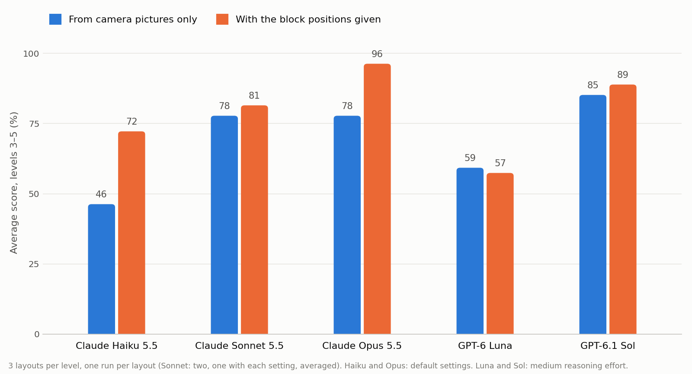
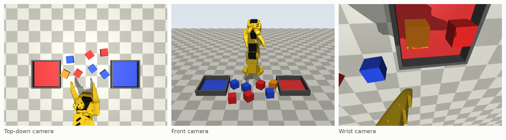

# Can AI models run a robot arm just by looking?

We explore a simple benchmark: can a model use camera feeds to control a robotic arm on various tasks? The model gets access to the robotic arm (SO-101) and its controls: move the gripper to a point, and open or close it. It also gets three camera views: top-down, wrist view, and front facing. The tasks are simple: sort, stack, sort while leaving a decoy block out, stack without the top-down camera, and copy a structure shown in a picture.

We found that the fastest models were the Claude 5.5 models, Claude Sonnet 5.5 above all, while the most accurate model was GPT-6.1 Sol, at 85% on the three harder levels.



## Why I did it

Frontier models are getting better quickly at many engineering tasks, and especially at coding. Robotics hasn't seen the same jump yet, at least not as visibly. This is the first in a series of benchmarks exploring how well models can control a robotic arm in simulation, directly from camera pictures!

## How the test worked

Each run gives the model a goal, four tools (look through a camera, move the gripper, open or close it, and park the arm) and a budget of 100 actions (130 actions for the messy sort). When the budget runs out, the tools stop working. The model never sees inside the simulator; it only knows what it sees in the pictures it asks for, plus where the gripper ended up after each move (the copy-a-picture level takes this away). When the model says it's done, the simulator checks the result: blocks in the right tray, how tall the tower is, or how closely the blocks match the target picture.



The three harder levels each ran on 3 random layouts, the same three for every model. Every run was then repeated with the exact block positions given, to tell apart a model that can't see from a model that can't do.


| Level | Task                                                    | What makes it harder                               |
| ----- | ------------------------------------------------------- | -------------------------------------------------- |
| 1     | Sort 2 red and 2 blue blocks into matching trays        | Fixed layout, step-by-step routine in the prompt   |
| 2     | Stack 4 blocks into one tower                           | Fixed layout, routine in the prompt                |
| 3     | Sort 3 red and 3 blue blocks, leave an orange decoy out | Random layout, no routine                          |
| 4     | Stack 4 blocks into one tower                           | No top-down camera, random layout                  |
| 5     | Build a 3-block structure shown in two target pictures  | Moves and grips report nothing back, random layout |


## Results

Score is the share of the goal reached, as a percentage, averaged over runs.

**Levels 1–2** (3 runs per model, same layout)

| Level    | Haiku 5.5 | Sonnet 5.5 | Opus 5.5 | GPT-6 Luna | GPT-6.1 Sol |
| -------- | --------- | ---------- | -------- | ---------- | ----------- |
| 1: sort  | 100       | 92         | 100      | 100        | 100         |
| 2: tower | 100       | 89         | 100      | 56         | 100         |

**Levels 3–5, from pictures only** (3 layouts per level)

| Level                   | Haiku 5.5 | Sonnet 5.5 | Opus 5.5 | GPT-6 Luna | GPT-6.1 Sol |
| ----------------------- | --------- | ---------- | -------- | ---------- | ----------- |
| 3: messy sort           | 94        | 100        | 100      | 89         | 100         |
| 4: tower, no top camera | 0         | 33         | 67       | 11         | 56          |
| 5: copy a picture       | 44        | 100        | 67       | 78         | 100         |
| **Average**             | **46**    | **78**     | **78**   | **59**     | **85**      |

**Levels 3–5, with the block positions given**

| Level                   | Haiku 5.5 | Sonnet 5.5 | Opus 5.5 | GPT-6 Luna | GPT-6.1 Sol |
| ----------------------- | --------- | ---------- | -------- | ---------- | ----------- |
| 3: messy sort           | 94        | 94         | 100      | 94         | 100         |
| 4: tower, no top camera | 67        | 67         | 89       | 67         | 67          |
| 5: copy a picture       | 56        | 83         | 100      | 11         | 100         |
| **Average**             | **72**    | **81**     | **96**   | **57**     | **89**      |

**Median time per run, in seconds** (pictures only)

| Level                   | Haiku 5.5 | Sonnet 5.5 | Opus 5.5 | GPT-6 Luna | GPT-6.1 Sol |
| ----------------------- | --------- | ---------- | -------- | ---------- | ----------- |
| 1: sort                 | 35        | 23         | 43       | 83         | 83          |
| 2: tower                | 37        | 28         | 74       | 192        | 178         |
| 3: messy sort           | 78        | 54         | 79       | 219        | 124         |
| 4: tower, no top camera | 154       | 234        | 234      | 341        | 323         |
| 5: copy a picture       | 93        | 52         | 137      | 288        | 121         |

Levels 1–2: all five models ran together, with medium reasoning effort. Levels 3–5: Haiku 5.5 and Opus 5.5 ran with default settings, Luna and Sol with medium reasoning effort. Sonnet 5.5 ran each layout twice, once each way, and its column averages both.

From pictures alone, GPT-6.1 Sol did best on the harder levels at 85%, with Claude Sonnet 5.5 and Claude Opus 5.5 tied at 78%. Given the block positions, Claude Opus 5.5 did best at 96%, so for most models the hard part was finding the blocks in the pictures, not moving the arm. The tower without the top camera was the hardest level for every model; no model averaged above 67% on it from pictures. Claude Sonnet 5.5 was faster than both OpenAI models on every level, often 2 to 7 times faster.

## Videos

Replays of real runs, re-simulated from the logs (not screen recordings), with the models' thinking time cut out.

**Level 4, tower without the top camera: all five models on layout 1** (Sonnet 5.5 with default settings)

https://github.com/user-attachments/assets/6e421bdb-f907-44eb-a979-17abee0975b0

**Level 3, messy sort: the Claude 5.5 models on layout 1**

https://github.com/user-attachments/assets/aad7e4a9-3fc7-4578-863b-83178d1784b9

**Level 5, copy a picture: the Claude 5.5 models on layout 1**

https://github.com/user-attachments/assets/ae4d712f-962b-4bd7-88a6-bd6cf23b7378

## What surprised me

- On the tower without the top camera, Claude Sonnet 5.5 finished with "Stacked 3 of the 4 blocks into a tower", but the simulator showed two blocks side by side with a third resting across them: a tower of 1.
- GPT-6 Luna scored 78% on copy-a-picture from pictures alone, but 11% when it was also given the exact block positions.
- Claude Haiku 5.5 knocked the decoy into the red tray while carrying a red block. It tried several times to fish it out, gave up, came back, and never got it out.


## Limits

- Each harder level has 3 layouts and one run per layout (two for Sonnet 5.5), so a single run moves a level's score by about 33 points. Sonnet 5.5's two sets of runs averaged 85% and 70% from pictures.
- Not every model ran with the same settings: the OpenAI models used medium reasoning effort, Haiku 5.5 and Opus 5.5 default settings, and Sonnet 5.5's column averages one run each way.
- It's a simulation: the arm goes exactly where it's told, the cameras are perfectly placed, and there's no camera noise.
- There's one prompt per level, written by me, and different wording could change the results.
- Time depends on each company's API speed, not just the model.


## What's next

When a model can do a task by controlling the arm itself, can it train a small neural network to do the same task on its own, with no AI in the loop, even from camera pictures? That's the next project, [robot-arm-teach](https://github.com/MoAwadalla/robot-arm-teach).


## Running it

Needs Python 3.13+ and [uv](https://docs.astral.sh/uv/).

```
uv sync
uv run python demo.py          # checks the setup: saves the three camera views and does one scripted pickup
```

Any model [Inspect](https://inspect.aisi.org.uk/providers.html) supports works, as long as it accepts images. Set that provider's API key first (`ANTHROPIC_API_KEY`, `OPENAI_API_KEY`, ...). Anthropic and OpenAI are installed; for other providers, add their package first (for Google: `uv add google-genai`).

```
# one layout of every level, to try it out
uv run inspect eval sort_task.py stack_task.py levels.py levels_coords.py --model <provider>/<model> --limit 1

# the full benchmark, as in the tables: levels 1-2 three times each, levels 3-5 on all 3 layouts, with and without positions
uv run inspect eval sort_task.py stack_task.py --model <provider>/<model> --epochs 3 --reasoning-effort medium
uv run inspect eval levels.py levels_coords.py --model <provider>/<model> --reasoning-effort medium
```

`--reasoning-effort medium` matches the published OpenAI runs; leave it out for the provider's default.

New logs land in `logs/` next to the published ones:

```
uv run inspect view                                   # browse every run, step by step
uv run python tools/tally.py                          # the tables, with your model as a new column
uv run --with matplotlib python tools/chart.py        # redraw media/chart.png
uv run mjpython watch_run.py logs/<file>.eval         # replay a run in a 3D window (Mac)
```

On a Linux machine without a screen, set `MUJOCO_GL=egl` so the cameras can render, or `MUJOCO_GL=osmesa` if it has no GPU.

## What's in here


| Path                            | What it is                                                                       |
| ------------------------------- | -------------------------------------------------------------------------------- |
| `cell.py`                       | The simulated arm, cameras, blocks and trays (MuJoCo)                            |
| `bench.py`                      | Shared pieces: the tools, random layouts, scoring helpers                        |
| `sort_task.py`, `stack_task.py` | Levels 1 and 2                                                                   |
| `levels.py`                     | Levels 3–5, pictures only                                                        |
| `levels_coords.py`              | Levels 3–5 with the block positions given                                        |
| `so101/`                        | The SO-101 arm model, from MuJoCo Menagerie (Apache 2.0, see `so101/LICENSE`)    |
| `demo.py`, `watch_demo.py`      | A scripted pickup, saved as pictures or watched live                             |
| `watch_run.py`, `pretty.py`     | Replay a logged run in 3D                                                        |
| `logs/`                         | Inspect logs of the 46 runs in the tables (open them with `uv run inspect view`) |
| `tools/tally.py`                | Works out every number in the tables from the logs                               |
| `tools/chart.py`                | Draws `media/chart.png`                                                          |
| `media/`                        | Chart, camera views and videos                                                   |


